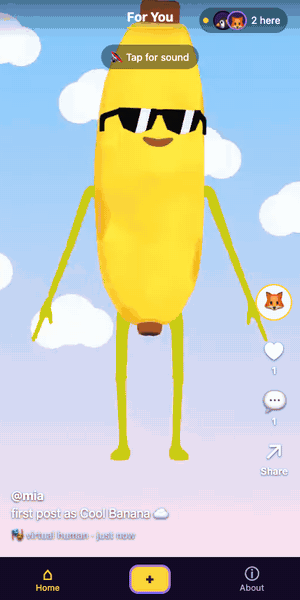
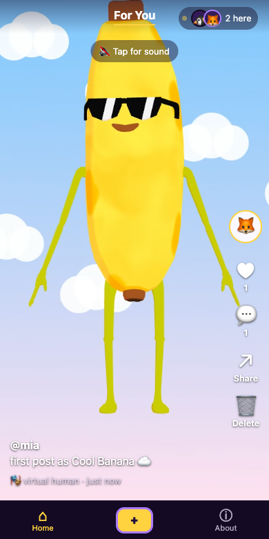
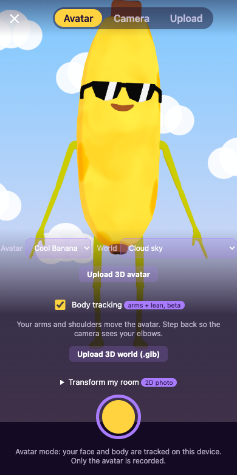
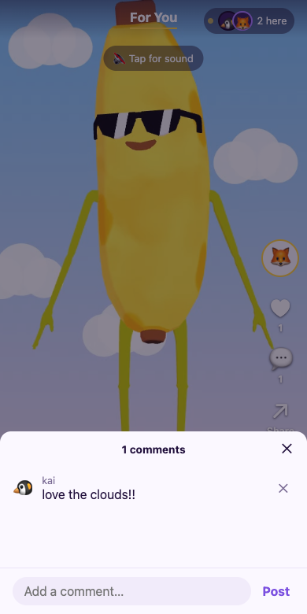

# Virtual Human Short-Form Video

A short-form video platform where anyone can record and share moments from their daily life as a virtual human. All you need is a webcam or phone camera.

  

| Feed | Studio | Comments |
| :---: | :---: | :---: |
|  |  |  |

*Test camera: avatars idle, not tracking.*

## What “Good” Means for This App

Good means a **social short-form video platform for virtual creators** that feels as easy as TikTok.

- **Simple.** A beginner can choose an avatar, record and post in under a minute, with nothing to install.
- **Genuinely functional.** Every button does what it says. The avatar follows you only when the model supports it. A restyled room photo is labelled as a flat 2D picture, not a 3D world, and an on-device colour filter is never called “AI”.
- **Private by default.** Face and body tracking run in your browser, so only the avatar is recorded and camera frames never leave your device. A room photo goes to an AI service only with your consent, photo by photo.
- **Social and live.** People share one feed. New videos, likes and comments reach everyone within about a second, without a reload. You see who is here now.
- **Fair and lasting.** The server, not the browser, decides who may change what: only you can delete your own videos and avatars, and each person can like a video only once. Posted videos survive reloads, restarts and redeploys.

When these conflict, privacy and user data come first, and visual polish comes last.

## How to Use This App (Instructions)

### Watch the feed

1. Open **Home** and swipe or scroll between videos.
2. Tap **🔇 Tap for sound** for audio.
3. Use the buttons on the right of a video:
   - **♥** to like it
   - **💬** to read or add comments
   - **↗ Share** to share its link
   - **🗑 Delete** to remove it, which only appears on your own videos
4. The top bar shows the avatars of people watching right now and how many are here.

### Create a video

1. Tap **＋** at the bottom of the screen to open the studio, and choose a mode:
   - **Avatar:** record as a virtual human
   - **Camera:** record as yourself
   - **Upload:** post a video up to 25 MB
2. In **Avatar** mode, allow camera access. Your head, blinks and mouth drive the avatar. Switch on **Body tracking** (beta) and your arms and shoulders move it too; step back so the camera sees your elbows. The camera image itself is never recorded.
3. Choose an **Avatar**: Cool Banana, Hotdog or Mushy, or **Upload 3D avatar** to use your own `.vrm` file (up to 15 MB). A plain `.glb` file also loads, but it can't follow your face.
4. Choose a **World**:
   - a **Standard** backdrop
   - a 3D world you upload as a `.glb` file
   - **Transform my room**, which turns a photo of your room into a stylised flat background. Step out of frame before the 5-second countdown ends.
5. Press record to start and again to stop. Recordings stop at 30 seconds.
6. Add a caption, pick an emoji and a display name, then tap **Post**, or tap **Retake** to try again. It appears in everyone's feed immediately.

### Good to know

- There are no accounts. Your browser is your identity. To use the app on a second device as the same person, open **About → Use on another device**, tap **Show a link code**, and type the code on the other device within 10 minutes.
- Uploaded avatars and worlds are private to you. Other people only see the videos you post.
- Body tracking covers your arms and upper body, not hands or legs. If your device can't keep up, it switches itself off and says so.
